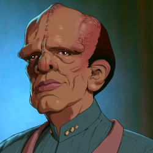

# Witless for the Prosecution (Part 4) 

 
<b>Session started at 2026-09-29 / 04:25</b>
 
Fantasy Grounds - v5.1.13 (2026-07-23) 
Fen's StarTrekAdventures Ruleset (v1.1.5)  
*[Prioritized Source: File; Other Sources: Vault]* 
*Core RPG ruleset (2026-07-14)
Copyright 2026 Smiteworks USA, LLC* 
*Fen's STA House Rules (v1.0.1) * 
*FG Browser v1.2.3* 
*[Prioritized Source: File; Other Sources: Vault]* 

>EXTERIOR - Pakled: Skig and her away team are standing in the street outside the Department of Written Down Stuff. In front of them, the building has been hastily fortified with a number of makeshift barricades and a pike wall fashioned out of waiting room chairs which have had their chair legs filed down to points. 

**Zox** What would be even more impressive if the chair-factory was automated, and they keep it on to make barricades... 
**Oakadan** This is violating so many safety regulations 
**Skig** I can completely empathsize with this level of customer service. 
**Captain Kaglor** But where will we sit while we wait for our number? 
**Oakadan** I think the main number they're using is a body count now 
*Skig looks for signs of dead Pakleds being used as the "take a number" machine.* 
**Oakadan: [ REASON  (10) +  ENGINEERING  (2)]
[Focus: Fire Safety ]
[Successes: 2] [Complications: 0]
Success with 1 momentum [2d20 = 11]** 
**Zox** What if the chairs are made of fire-resistant materials? 
**Skig: [ INSIGHT  (8) +  SECURITY  (3)]
[Focus: "Masking" ]
[Successes: 0] [Complications: 0]
Failed on DC: 1 [2d20 = 31]** 
**Zox** Surely, they wouldn't be silly enough to remove those labels, that'd be just plan daffy. 
*Skig shrugs when she doesn't see a plle of dead Pakleds with numbers attached to them.* 
**Oakadan** I'm thinking more to do with the barricades 
*Skig looks for an entrance and signs of people inside the barricades. (Also looks for signs of cannibalism from people inside the barricades, but we'll get to that in a bit.)* 
**Oakadan** We've got windows on the upper floors which we may be able to enter through 
*Zox blinks in a toughtful concerted manner.* 
**Oakadan** We can scale the neighboring buildings and rappel down 
**Skig** We could just... use the transporter to go to the roof and work our way down? 
**Zox** Call down the Exo-Skig-Aton, equip urban configuration J! 
**Captain Kaglor** Hmm, Skig is wiser than Oakadan 
**Captain Kaglor** But Oakadan is more adventurous 
**Skig** I mean, as excited as I am to use these SWOL legs to just kick through the barricades, that seems like an unnecessary amount of work that might upset the people on the other side of them. 
*Skig pushes comm button.* 
**Skig** Skig to Lister, can you transport the Away team to the top of the building in front of us, highlighted with the tricoder beam? 
**Skig** No Zox, you do not get to destroy another urban location with fire-breathing goodness.... yet.... 
**Zox** I'm patient. 
**Skig** I prefer to keep our options open though, so I will weigh that accordingly. 
**Lt. Cmdr Malat** Aye ma'am, energizing 
**Oakadan** Honestly that might be the most fun they've had in years if he did that 
>The away teams beams up to the roof. There, they find several skylights spread across the large, flat roof. The interior looks like a predominantly industrial space, although the lights are out they can see a few places with large machinery. There are also several areas of small offfices. In the darkness, they can see a handful of Pakleds patrolling the halls. 

**Oakadan** What kind of machines are those?  
**Zox: [ INSIGHT  (7) +  SCIENCE  (4)]
[Successes: 2] [Complications: 0]
Success with 1 momentum [2d20 = 11]** 
**Skig** Copiers, printers, or printing presses would be my first guess. 
**Zox** Perfect. 
**Skig: [ INSIGHT  (8) +  COMMAND  (2)]
[Successes: 1] [Complications: 0]
Success with 0 momentum [2d20 = 28]** 
**Zox** Um.....That's no longer a machine, not even a contraption.....it's just what they _think_ should be a machine because it has all the qualities they associate with one. 
**Oakadan** Oh no 
**Zox** A crude facsimile..one could say a simulacrum. 
**Skig** Good point, I forgot the likelihood of them using a facsimile machine. 
**Skig** So the building seems to be on emergency power and the Pakleds are carrying around firearms, although what they are defending and who from would be good questions... 
**Oakadan** If we can figure that out, we can probably bambooozle them 
**Captain Kaglor** I am not so sure, the employees of the Department of Written Down Stuff are very smart 
**Captain Kaglor** They can read 
**Zox** You can't? 
**Skig** I would prefer to avoid the situation of indiscriminately burning down buildings or killing people, Bachar would get an upset stomach and it might look poorly to Lt Cmdr Buttermilk for his investigation. 
**Skig** Wait... they can read? 
**Skig** Hmm.... Zox, this strikes me as a great opportunity to use a sheet of paper and a fishing pole. 
**Zox** Yes Commander! 
**Oakadan** Do we have official-looking forms that we can drop down that request our necessary form?  
**Oakadan** What about the department we just came from? Do they have any completed forms that we can copy?  
**Oakadan** Wait, do the Pakleds know what the right forms look like? 
**Skig** I have some serious doubts they have any idea what the official form looks like. 
**Skig** We could nominally just create something. 
**Oakadan** Can we have someone on the ship print us the right form? Surely one of their databases has a scan of one somewhere, right?  
**Skig** Err... can we just connect to the planet-wide chat boot by going to http://localhost from the wifi router and entering a blank page. 
**Oakadan** Potentially?  
**Zox** World wide chat bot you say? 
**Skig** Then just ask the chat bot to update the information for us with some good prompt injection? 
**Skig** I mean, if we are standing on top of a roof contemplating life, the universe, and everything, let's think outside the box. 
**Oakadan** Let's just try printing off a piece of paper that just requests the form 
**Captain Kaglor** Captain Kaglor does not understand, but Skig is wise so her idea must be the best one. 
**Skig** Thank you Kaglor. While Oakadan is printing out the form I'll see what Clippy-Pakled has to say. 
*Skig opens a private browser tab and goes to the localhost on the wifi router with the strongest signal.* 
**Oakadan** Windbloom, could we have you print off a request form for us?  
**Oakadan** No cursive though 
**Skig** Kaglor, do you happen to know how to get to Clippy-Pakled or how do you use it normally? 
**Skig** OH MY GOD! They have planetwide DNS resolution failure! 
*Skig goes feral and begins barking and bites Zox.* 
**Zox** Ow! 
indarien (Skig): JUST KIDDING. It's funnier if you have seen the video. 
**Captain Kaglor** You just ask the computer, and it answers. But the computers seem to be off 
**Skig** Hmm... open wireshark, start a packet capture, start a connection attempt, see which address is failing to respond... 
indarien (Skig): Wait a minute! When did this turn into work? 
**Zox** Skig, if we really want to fix this, we need to hack the global Clippy-Pakled AI and then make the program ask the user questions instead of providing answers. 
**Skig** Yes, that seems like a good start once we identify why the primary hosting service is down, and then restart it. 
**Oakadan** Fantastic! Beam down a fishing rod, please. We're going to send this down and see if we can get it 
indarien (Skig): If it turns out the problem is a page caching fault on a load balancer I'm flying to the Netherlands and smacking Fen in person. 
*Oakadan shows off the most beautiful form* 
*Skig has heart eyes for the beauty of ancient communication methods.* 
**Zox** An engineer would be appreciative no? Perfect design within constraints, wheres there's no constraints of modern coms? 
**Skig** Exactly, it is like the ancient medium of communication known as the level 3 Sending spell, which has a limit of 25 characters and is UDP based. 
indarien (Skig): "words" not "characters" ... but  sense a level 1 variant has just been created. 
*Captain Kaglor counts up the away team members.* 
**Captain Kaglor** There are only four characters here, so we should not have a problem then 
*Skig pats Kaglor on the head.* 
**Skig** Good Pakled, have some diaeletric material. 
*Skig is going to troubleshoot to identify where the main Clippy-Pakled instance is physically located.* 
*Oakadan hooks the letter on the end of the fishing line and sends it down to the first floor, dangling it around for some of the patrols to find. * 
**Oakadan: [ CONTROL  (11) +  CONN  (2)]
[Successes: 1] [Complications: 0]
Success with 0 momentum [2d20 = 26]** 
**Skig: [ REASON  (10) +  ENGINEERING  (5)]
[Successes: 3] [Complications: 0]
Success with 2 momentum [2d20 = 10]** 
*Zox uses his hadrosaur skull to make elegant noises.* 
**Zox: [ CONTROL  (11) +  SCIENCE  (4)]
[Focus: Music ]
[Successes: 3] [Complications: 0]
Success with 2 momentum [2d20 = 13]** 
**Zox** Wwwwwwwsssssh. Whssssssis. Drop drop. Whasssssssss. <boat noise> Whssssssh CAW CAW 
**Zox** Welcome to paper work fishin! Im zox, and today we are gonna catch the exotic paper pushers of Pakled with a #2 type spinner form. 
*Zox calming water noises continue* 
>Oakadan lowers the paper down on a fishing rod while Zox makes... noises. The nearby Pakleds hear the sounds and turn around to see the paper floating in mid-air. They look up to see where the noise is coming from, and see Zox sticking his head through the skylight making water sounds 

**Government Employee** Why are you on the roof? 
**Zox** You are seeing things, im not here. 
**Government Employee** Request forms are not submitted on the roof, they are submitted at the Form Request Desk 
**Oakadan** Ask them which way to the form request desk 
**Zox** Oh really? where would that be? in relation to office furniture mountain and the paper-clip caltrops field? 
**Skig** Wait? They made a field of caltrops out of paper clips? 
**Skig** These Pakleds are awesome. 
**Zox** They take their duty to defend the contraption seriously. 
**Oakadan** You're just saying that because those swole legs of yours are immune to caltrops 
**Government Employee** The Form Request Desk is down that hall, near the entrance to the building 
**Government Employee** But it is inside the building, not on the roof 
**Zox** Thank you! 
**Government Employee** Why would we put the Form Request Desk on the roof, it is too important to be on the roof 
**Skig** You might want to ask if we can come down to the Form Request Desk AND why they put up barricades? 
**Zox** Ill make sure to let the office of employee evaluations know you are the best help at the agency of writing stuff down. 
*Skig resumes tapping away at her tricoder.* 
**Government Employee** Oh, thank you, but the survey app is broken now 
**Zox** Have you considered filing paperwork for that? here we can go together to the desk... 
*Zox slinks down the building and approaches the guard in a friendly manner* 
**Government Employee** We cannot file that paperwork until the war is over 
**Government Employee** We are busy now 
**Zox** War? What war? 
**Government Employee** The war with the Maintenance Division 
*Skig blinks.* 
**Zox** But if we resolve this conflict, we can submit both our requests? 
**Government Employee** Yes, once we have defeated the Maintenance Division we will be able to finish repairing the printer 
**Government Employee** Then we can print your form 
**Skig** When did the war start and what has the maintenance division done? 
**Zox** Passed sweeping legislation and cleaned out the treasury. 
**Zox** No really what did they do? 
**Government Employee** When the main computer went down, the Maintenance Division tried to use the old computer to tell them how to fix the printer 
**Government Employee** But they are dumb, we have the original printed manual for the printer 
**Government Employee** The manual is the one true word, and we must follow the manual to fix the printer 
**Government Employee** The Maintenance Division are heretics, and must be eliminated. Sad. 
**Captain Kaglor** That makes sense. 
**Skig** Can you *show* me the manual? 
**Zox** They do not appreicate perforated printing paper of the olde ways? 
**Government Employee** No, we do not have it 
**Government Employee** Tolokrik has the manual 
**Government Employee** Why would we have the manual, we are guarding this door, not fixing the printer. You are not smart. 
indarien (Skig): It's a hologram of James T Kirk... who starts every sentence with Yolo.... hence... T'olo'kirk! 
**Zox** Can we meet Tokokrik? 
**Zox** Tolokirk? 
**Government Employee** I am not his mother 
**Skig** Your door guarding skills are so amazing I mistook you for someone as smart Tolokirk. 
**Skig** You deserve an extra, second, positive survey response for that. 
**Skig** Pss... Zox and Oakadan, I pinpointed the main computer, it's in a sub basement about 3 km from here. It is powered but the data feeds are offline. We should probably just see if we can bring it back online in a "learning" manner to educate the Pakleds. 
**Zox** Yes please! 
**Zox** It will take decades but hopefully we can reverse this psychological rot. 
**Oakadan** Do we want to get that after we set up the paperwork? 
**Skig** Nah, the main computer probably discovered Orion-Tok and has been watching dance videos and overran its bandwidth allocation for the millennia. 
**Skig** I'm thinking these people listen to what the main computer tells them, we bring it back online and then we can fix everything without having to deal with the individual bits along the way. 
**Skig** Zox, get me a few thousand adorable cat videos to distract them all. 
**Zox** Oh sure! Mental Soma, go! 
**Skig** Use the /r/eyebleach feed for a good start. 
**Zox** Also this is a space-faring civilization so the prime directive is null and void as we attempt to course correct it. 
**Skig** That was on my checkbox for, "This is completely fine." 
**Oakadan** I do have to ask why nobody has taken action here in the last few centuries 
**Oakadan** Surely someone has visited this place, yes? 
**Zox** Would you tourist a place like this? 
**Skig** I doubt anyone named "Surely someone" has visited this place. 
**Zox** Honestly Okadan, this is somewhat refreshing 
**Zox** While depressing, losing a civilization to mental atrophy might be more reversable than some of the situations out there. 
**Skig** Right, mental atrophy can be overcome more easily than nuclear holocaust or deep-fried grasshopper eating fads. 
**Zox** I mean take your pick, being a bumpkin here or being on Bajor or Vulcan during their....hiccups.... 
**Zox** THat precisely 
**Zox** Wait, did some civilizaiton invite ecological catastrophe by eating all their insects? 
**Zox** OH THE TRAGEDY! Not the bugs! Bug is fren! 
**Skig** Yes, the Formacalites entire civilization was destroyed when they decided the primary predator for a particularly nasty diease carrying rodent was a delicary and ate it to extinction. 
**Oakadan** That is an absolute tragedy, I remember reading the research on that  
**Skig** Then the rodent, which was toxic and inimical to all other life, overwhelmed their medical system and caused a system wide plague that exterminated the entire species. 
indarien (Skig): (Actually, I probably spelled that wrong, and it's from Babylon 5...) 
Masakari (Zox): "When you download so much brainrot subspace rips" 
**Zox: [ REASON  (7) +  CONN  (1)]
[Successes: 1] [Complications: 0]
Success with 0 momentum [2d20 = 17]** 
>As the away team prepares to beam out, they hear the sounds of distant gunfire. 

>Another employee comes running into the printer room shouting 

**Zox** Huh. I thought I solved that problem 
**Government Employee** We need backup, the Maintenance Division is attacking. And our guns don't work 
**Oakadan** What are they attacking with? 
**Government Employee** Their guns ARE working 
**Oakadan** That is a big problem 
**Skig** Energize! 
**Skig** Wait... why are your guns not working? 
**Zox** It's my fauklt. I thought this war was internal to the building and disabled as many weapons as possible. 
*Skig looks suspiciously at Zox as they vanish into the transporter beams.* 
**Zox** Both for our saftey and for the Pakleds 
**Oakadan** Uh oh 
**Oakadan** Our deal may not still apply to the Maintenance Department, especially if they break things 
>The away team dematerializes from the Department of Written Down Stuff and materializes in the square outside the Chambers of the Brain Trust 

**Skig** Okay, we head this way. 
*Skig follows route prepared by Lister's sensors to reach the computer vault.* 
**Oakadan** We've gott ago fast 
*Zox follows attentively.* 
>Skig heads into the building. Inside, she finds a large marble audience chamber, with nine ornate seats surrounding an open chamber. The space is empty, dark, and quiet. But she sees no stairs or lift down to the sub-basement. The building appears to have a slab-on-grade construction, with no intended route to whatever is under the ground. 

**Skig** Zox, if they took the time to barricade all entrances to the building... why would you possibly think the conflict was internal to the building? 
**Zox** I suppose you are correct...didn't really know about the war when we got in. Could be one of those little-word things where one tribe takes part of the buid.....Okay you win. 
Masakari (Zox): little world* 
*Skig runs a sensor sweep with her tricoder (assisted by the Lister) to find how to get to the sub-basement.* 
**Skig: [ REASON  (10) +  ENGINEERING  (5)]
[Successes: 2] [Complications: 0]
Success with 1 momentum [2d20 = 15]** 
**Skig** Wow, they defended this really well. 
**Captain Kaglor** The Brain Trust are very smart 
**Captain Kaglor** They are the smartest Pakleds 
**Zox** Maybe we get to the real bottom of this, and there's an alien manipulating the Pakled civilization so it can data mine them. 
**Captain Kaglor** You cannot mine Pakleds, we have blood and guts inside 
**Skig: [ REASON  (10) +  ENGINEERING  (5)]
[Successes: 1] [Complications: 0]
Success with 0 momentum [2d20 = 23]** 
*Skig gets out her cladding etching kit and not her vampire taps kit, because Gra'lan is not here to use that.* 
**Zox** See, this would be a great Gra'lan redemption arc. 
**Skig** Okay, so the ODN lines are dead, but the main computer has power. Auxiliary chat systems work, but if everything is offline then I doubt it would be downstream systematic. 
**Zox** He could save a civilizaition here 
**Oakadan** Are those relatively easy fixes?  
**Skig** Well, except that we need to get through 6 meters of solid ground and a forcefield. 
**Skig** Or somehow be 1" tall and walk through the ODN condcuits. 
indarien (Skig): "conduits" 
**Zox** I can take care of one of those problems. 
**Zox** Let me know commander. 
**Skig** Which problem? 
**Zox** The forcefield or the ground 
**Oakadan** Dang, no minizox 
**Skig** I am also disappointed in the answer Oakadan. 
**Skig** Ground first, to get to the forcefield. 
**Skig** The Lister cannot detect any way to get there. 
**Zox** 6 Feet of Pakled Concrete is no problem! 
**Zox: Zox has used a point of Determination to add a natural one to the dice pool.** 
**Zox: [ FITNESS  (10) +  SECURITY  (5)]
[Successes: 3] [Complications: 0]
Success with 2 momentum [2d20 = 23]** 
**Skig: [ DARING  (10) +  ENGINEERING  (5)]
[Successes: 0] [Complications: 0]
Failed on DC: 1 [d20 = 16]** 
>Zox activates continuous tunneling mode on his exosuit and begins to physically bore a hole through the marble tile, concrete foundation and solid rock using his arms and not his phaser. 

**Zox** Honest Manual Labor! 
>As the away team watches Zox tearing the ground into tiny pieces and flinging it around the ornate marble room, they are interrupted by a comms call from Commander Buttermilk 

**Skig** It seems appropriate that we would use the Drill Bore setting instead of the Terrain Manipulator setting. 
**Commander Buttermilk** Commander Buttermilk to Commander Skig, I hate to interrupt but you will need to return to the Lister in accordance with Starfleet operating procedures 
**Skig** Certainly. 
*Skig turns off comms.* 
**Skig** Zox, don't make me regret leaving you in charge. 
**Zox** Uh.... 
*Skig turns comms back on.* 
**Zox** Mea Culpa? 
**Zox** Also I can't hear that over how awesome the drills are =D 
**Commander Buttermilk** You are required to assume command, I have placed Captain Bachar into custody pending her court martial. 
**Skig** Lt Cmdr, beam me up to meet with Lt. Commander Buttermilk... 
>♫♫♫Ominous Music Sting♫♫♫ 

*Skig turns off comms.* 
**Skig** SHIT!!!!!! 
>---------CUT TO CREDITS------- 

>---------CUT TO COMMERCIAL------- 

