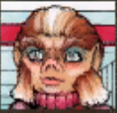
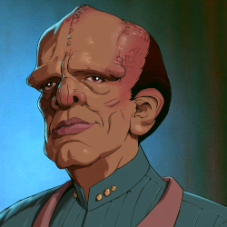
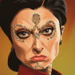
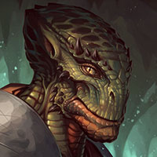
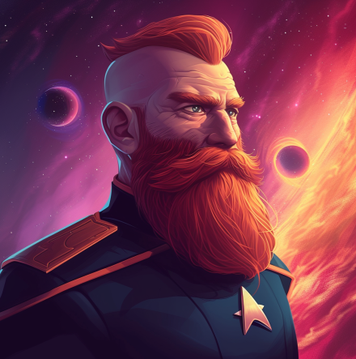

# Witless for the Prosecution (Part 5) 

 
<b>Session started at 2026-10-20 / 04:09</b>
 
Fantasy Grounds - v5.1.14 (2026-10-19) 
Fen's StarTrekAdventures Ruleset (v1.1.5)  
*[Prioritized Source: File; Other Sources: Vault]* 
*Core RPG ruleset (2026-10-06)
Copyright 2026 Smiteworks USA, LLC* 
*Fen's STA House Rules (v1.0.1) * 
*FG Browser v1.2.3* 
*[Prioritized Source: File; Other Sources: Vault]* 

>INTERIOR - Briefing Room: The remaining senior staff gather in the briefing room to hear Commander Buttermilk explain the charges against Captain Bachar.  

**Skig** Oh good, Gra'lan you are here. I need your help diagnosing a problem with a murderous Klippy-Bot. 
**Gra'lan** The Oatmeal in the brig is too mushy. And there's no tools, and the chairs aren't contouring, and there's no slippers! 
**Gra'lan** Klippy? Wasn't that agent banned as a warcrime in 2121? 
**Skig** I will make a note of your concerns. Have you considered possibly not breaking multiple major laws in the name of love? 
**Skig** Yes, that Klippy. 
**Gra'lan** Can breaking laws with Klippy un-break laws broken out of love? 
*Skig blinks.* 
**Commander Buttermilk** Thank you all for coming. The first order of business: In accordance with Starfleet regulations, I am authorizing a temporary transfer of command of the USS Lister to Commander Skig until the preliminary hearing is complete. If charges are brought against Captain Bachar, Starfleet will assign a new commanding officer. If no charges are filed, the captain will be free to resume her duties 
**Skig** No? 
**Gra'lan** Also those primitives wouldn't know what to do with that rock! Only a classy girl could wear it....and possibly eat it. 
**Skig** Sorry, that was directed at Gra'lan, not you Commander Buttermilk, please proceed. 
*Skig makes shushing hang gesture noises at Gra'lan.* 
**Commander Buttermilk** The purpose of this meeting is to explain the charges against Petty Officer Gra'lan and Captain Bachar prior to their evidentiary hearings.  
**Skig** I see. Carryon on? 
**Commander Buttermilk** I have contacted Starbase 26 and a JAG flag officer is on their way here to preside over the evidentiary hearing and arraignment 
*Skig gets out a stack of 3x5 cards with Kolea's hand writing on them.* 
*Skig nods.* 
Masakari (Gra'lan): Zox not hearing the order to come back woudl be sort of funny tbh/ 
**Commander Buttermilk** First, petty officer Gra'lan is charged with: first degree larceny, a direct and wilful violation of the prime directive, and conduct unbecoming. 
indarien (Skig): Wait... so we have left Zox UNATTENDED on a planet? 
KruschtyaEquation (Oakadan): lmao Oakadan can stay down there 
**Gra'lan** I hear two crimes, the first one is at best a misdemeanor. 
**Commander Buttermilk** The evidence against him is... insurmountable.  
**Gra'lan** second one rather. People break that twice an episode. 
**Skig** Yes, this is far worse than when he forgot to rewind the VHS tapes in the crew lounge on deck 16. 
*Skig flips through the 3x5 cards until she finds one.* 
**Skig** "Thank you for bringing this to my attention, <say rank and name here> I will be happy to look into it." 
*Skig pauses.* 
*Gra'lan claps* 
**Skig** Hmm.... I think those are variables. 
*Gra'lan looks around the room for others to clap* 
**Commander Buttermilk** As for Captain Bachar, I am seeking an indictment on charges of aiding and abetting a changeling infiltrator. 
*Skig invokes shocked pikachu face.* 
**Skig** Really? 
**Commander Buttermilk** It is clear to me that there is a founder on this vessel, and it is so obvious that it must be clear to her as well. And mysteriously, this Ensign Geret is sent off the ship just as I arrived. 
**Skig** Ah. 
**Skig** Errr.... 
**Skig** Geret is a... 
**Commander Buttermilk** The only rational explanation is that Ensign Geret is a changling infiltrator, she has used a cover identity as some other shapeshifting species to evade detection 
*Skig digs through stack of 3x5 cards.* 
**Commander Buttermilk** And she has assassinated a Starfleet Admiral 
*Skig pauses.* 
**Commander Buttermilk** When she returns to the Lister, she will be charged with impersonation of a Starfleet officer, and homicide 
**Skig** Wait... that is... kind of maybe possible? 
Masakari (Gra'lan): Waitng for a rafffle prize announcement from Skig's cards... 
*Skig roots through 3x5 cards.* 
**Skig** Thank you for your diligence.... Commander Buttermilk... I will take these charges seriously. 
*Skig pauses.* 
**Commander Buttermilk** Captain Bachar and Petty Officer Gra'lan will require representation  
*Skig seems happy to have figured out how the variable names on Kolea's cards work.* 
**Commander Buttermilk** The purpose of the preliminary hearing will be to establish whether there is sufficient evidence to begin a court martial against the suspects. 
**Commander Buttermilk** If there is, the suspects will be transferred to Starbase 26 to face trial 
KruschtyaEquation (Oakadan): Of which Gra'lan is a "definitely" lol 
**Gra'lan** I don't need a lawyer, I just need that Rock and Roll with Gemma! <swoon> You know she was part of the Rockettes? 
**Skig** Commander Buttermilk, I believe the best approach will be to have Geret thoroughly investigated on return. If she is actually a Founder and not a ... whatever she is that I forget... then it will be evident. 
**Commander Buttermilk** I will remind you that you have a right to remain silent. 
**Skig** Err... 
*Skig pauses.* 
**Skig** Oh, you meant Gra'lan. 
KruschtyaEquation (Oakadan): Someone needs to make sure Gra'lan gets a lawyer lol 
**Commander Buttermilk** Starfleet has had robust changling detection programs for the past decade, and our infiltrator has evaded them. A failure to prove that Geret is a founder is not dispositive 
**Commander Buttermilk** Absence of evidence is not a bird in the hand. 
KruschtyaEquation (Oakadan): Assuming that there *is* a changeling 
KruschtyaEquation (Oakadan): I think we were saying that there wasn't really a changeling, and that it was all paranoia 
**Skig** True, as I believe the Captain has been under undue strain lately, a few days off while this is sorted will do wonders for her. As a result, I will have her confined to quarters pending the outcome of the Evidentiary hearing. 
**Commander Buttermilk** That is reasonable. 
**Skig** And... uh.... 
*Skig sorts through the cards some more.* 
**Skig** Commander Buttermilk, do you have any other concerns at this time? 
**Commander Buttermilk** I didn't bring enough changes of clothes. I will need to replicate another suit. 
**Skig** Not a problem, your quarters are acceptable, I presume? 
*Skig sorts through cards.* 
*Skig is definitely not cut out for the "Captain" stuff and really wants this nightmare to end before someone asks her something that requires actual Command skill points.* 
**Commander Buttermilk** Now if there is nothing else, I will leave you to your duties. The presiding officer for the hearing will take a day or so to arrive, so you can use that time to prepare your defense. 
**Skig** Very well. 
**Lt. Cmdr Malat** I reached out to the advocate who represented me when I was charged with assault 
**Skig** Malat, can you escort Gra'lan back to the Brig? I will escort Ms Bachar to her quarters. 
**Lt. Cmdr Malat** Aye ma'am 
**Skig** Thank you Malat. 
*Skig does not ask her burning question of, "Which time you were charged with assault, and did you win or lose that case?"* 
KruschtyaEquation (Oakadan): I imagine we could look that up lol 
**Windbloom Openheart** This is pretty wild. I had no idea Geret was a founder 
KruschtyaEquation (Oakadan): What's the win record on this guy 
*Gra'lan eyes Windbloom while being perp-walked out.* 
**Skig** Indeed it is. 
*Skig sorts through some cards.* 
*Skig picks one out.* 
**Skig** Thank you Windbloom for your help in addressing the crew's concerns during this trying time. 
**Gra'lan** Thanks Malat.  
*Skig shows card to Windbloom.* 
**Skig** I'm not sure how to read these heart symbols... but they are on this card for some reason. 
**Windbloom Openheart** That means you should try to show compassion when you say it 
**Skig** Oh... I see. 
**Windbloom Openheart** You did a good job, I almost believed you cared about the crew 
*Skig scribbles down on her PADD, "heart mark = try to sound compassionate"* 
**Skig** Thanks. 
*Skig gestures for "Ms Bachar" to follow her out of the briefing room.* 
*Zox Is still drilling. Drilling. * 
*Captain Bachar walks with Skig into the hall* 
*Skig gives Bachar a "wide-eyed" look of "What the Fuck am I doing?" and hopes for something approximating useful pointers other than surviving on Kolea's 3x5 cards.* 
*Oakadan directs Zox and makes sure he's taking his mandated breaks from rock pummeling* 
**Captain Bachar** Don't worry Skig, I doubt that the Lister is going to be in any major peril while you're in command. 
**Gra'lan: [ DARING  (7) +  SECURITY  (2)]
[Focus: Sharp Weapons ]
[Successes: 1] [Complications: 0]
Success with 0 momentum [2d20 = 22]** 
**Captain Bachar** If I am court marialed, then I am sure Starfleet will assign a suitable replacement commanding officer 
**Skig** Oh, it's not the ship I worry about, it's surviving handling the crew. 
**Skig** Engineering things I can fix, anything else I fail at and I am not too proud to admit it. 
**Captain Bachar** The captain is responsible for the ship, the XO is responsible for the crew. Your first lesson in command: delegation. 
Masakari (Gra'lan): Throk, to seek out new flavors and dishes, to feast where no one has feasted before! 
**Skig** Umm... since Hailey is not here, I think maybe Kolea would be a good XO... because then I can give her back all her 3x5 cards? But... would that offend people because that's really jumping around the chain of command? 
**Skig** Wait... did I just ask if I was worried about offending people? BY TELMAR'S HAMMER, I'm sounding like... not me? 
**Skig** I need a drink. 
**Captain Bachar** Command does that to you. Just be careful not to do anything that will get you charged with a crime by Buttermilk 
**Throk** Funny engineer lady has just had brain shift into neutral. 
*Gra'lan nods to skig, being old enough to get it.* 
**Skig** Yes, I shall assist in his efforts to determine if Geret is a Founder and perform to my usual level of competence on interpersonal skills. 
*Skig is happy that just lowered the bar to nothing.* 
*Captain Bachar reaches her quarters and opens the door, then turns back to Skig.* 
*Skig wonders if Zox has caused a genocide yet on the planet or not.* 
**Skig: [ INSIGHT  (8) +  SECURITY  (3)]
[Successes: 1] [Complications: 0]
Success with 0 momentum [2d20 = 22]** 
**Captain Bachar** One last thing: keep a close eye on Gra'lan before he gets himself into even more trouble. He slipped me a plasma torch and a note encouraging me to escape. 
*Captain Bachar hands a plasma torch over to Skig* 
*Skig takes them from Bachar.* 
**Skig** Umm.... 
**Captain Bachar** He's going to make things worse for himself if he isn't careful 
**Skig** Yes. 
**Skig** Good luck to us all, Captain. 
*Skig heads down to the Brig to have Gra'lan confined to his underroos in solitary confinement.* 
**Captain Bachar** If I had any sage advice I would give it, but "good luck" is as good as anything I can come up with 
**Zox** It's too damn cold! 
**Gra'lan** It's too damn cold! 
*Skig stops, turns around to make sure Bachar actually goes into her quarters and locks the door so Buttermilk can't charge Skig with letting Bachar wander free on the ship.* 
*Skig turns up the heat to a balmy 36C in the solitary confinement cell.* 
**Skig** So... Malat, how did Gra'lan get a plasma torch? 
**Lt. Cmdr Malat** I gave it to him 
**Skig** Oh good. 
**Lt. Cmdr Malat** We can't let them railroad Bachar like this 
KruschtyaEquation (Oakadan): WHAT 
*Skig hands the plasma torch over the Malat.* 
**Skig** Excellent. 
**Skig** Have you ever considered being the  XO of a starship for a very short period of time? 
Masakari (Gra'lan): We have no malice; greed, mischief, farce, but no intent to cause harm. 
indarien (Skig): I don't know, there is a decent amount of farce from time to time. 
**Lt. Cmdr Malat** I... not really, ma'am 
**Skig** That's what I told Bachar when she promoted me. 
**Skig** But I think you are best suited right where you are, if that works for you. 
*Skig blinks.* 
**Skig** So... please continue to perform your duties to the best of your ability and also please take advantage of the current ship captain's mostly blistering incompetence when it comes to interpersonal skills to address your concerns about railroading. 
*Skig winks and walks away.* 
*Lt. Cmdr Malat nods and heads to the turbolift* 
*Skig heads to the medical bay.* 
*Kolea sighs.* 
**Kolea** Sure... 
**Skig** But I haven't said anything? 
**Zox: [ INSIGHT  (7) +  SCIENCE  (4)]
[Focus: Espionage ]
[Successes: 0] [Complications: 1]
Failed on DC: 1 [2d20 = 32]** 
**Kolea** There's a transmitter in the 3x5 cards, it's the four stuck together. 
**Oakadan: [ REASON  (10) +  COMMAND  (4)]
[Successes: 1] [Complications: 1]
Success with 0 momentum [2d20 = 33]** 
**Skig** Oh. 
**Oakadan** It says we have to go down 15 meters 
>♫♫♫Lighthearted Music Sting♫♫♫ 

